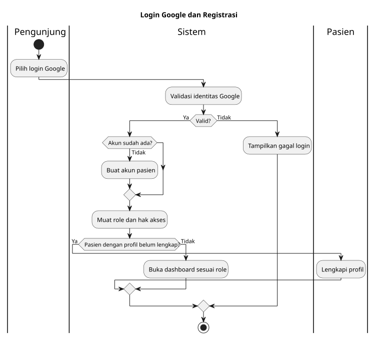
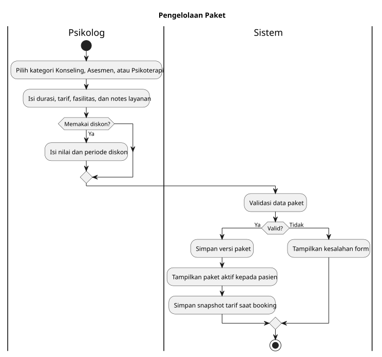
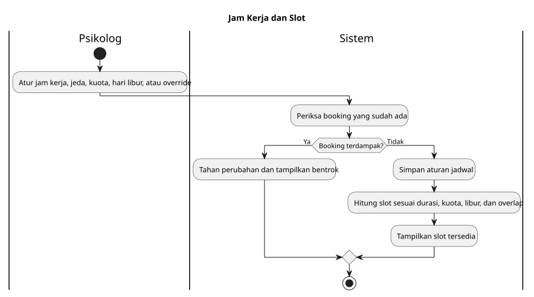
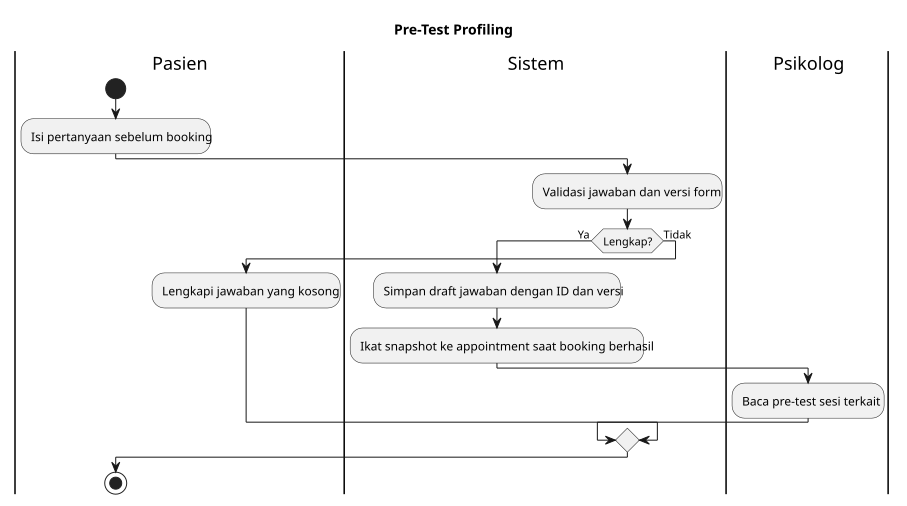
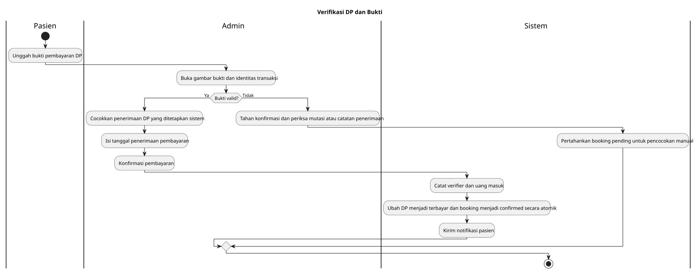
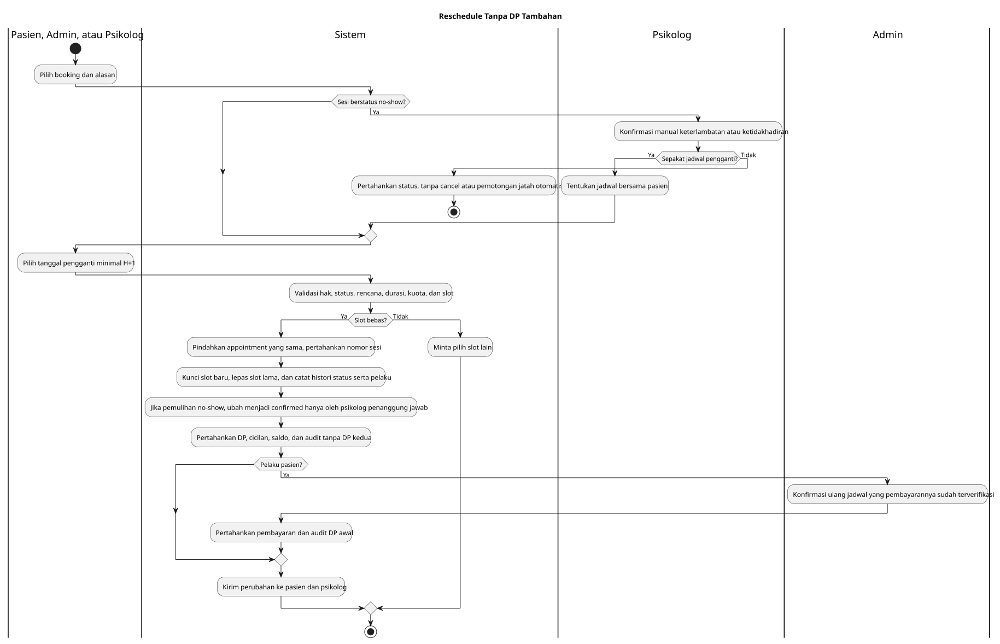
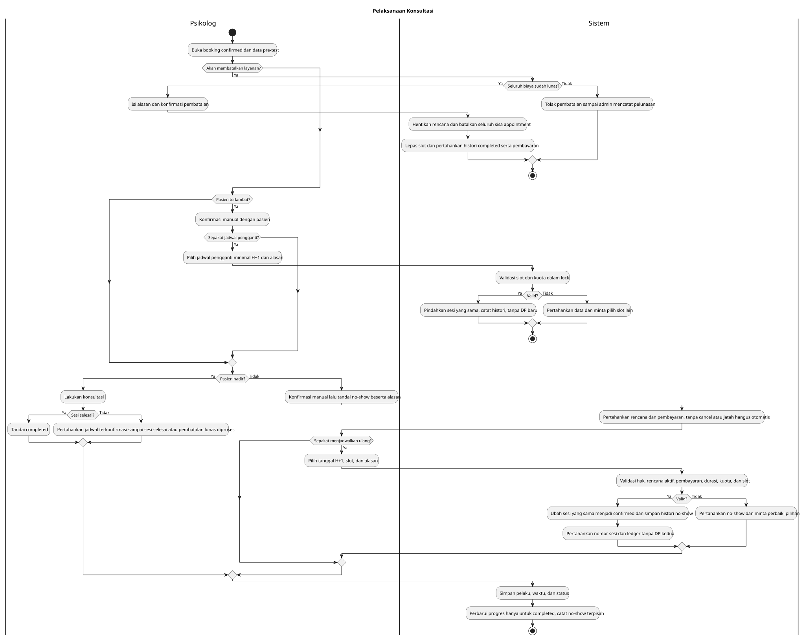
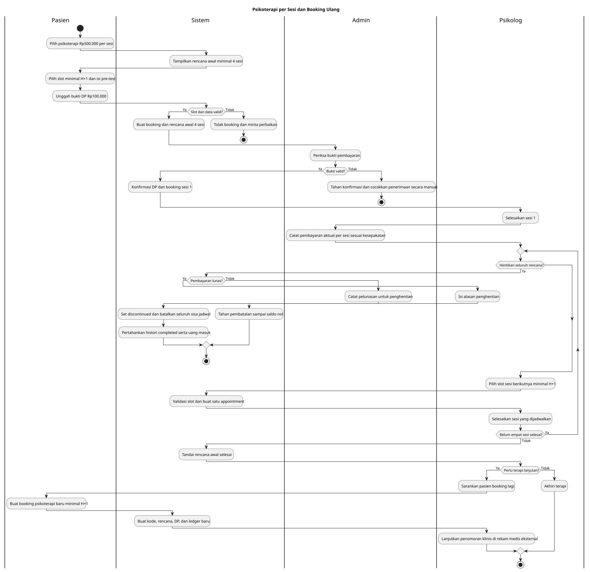
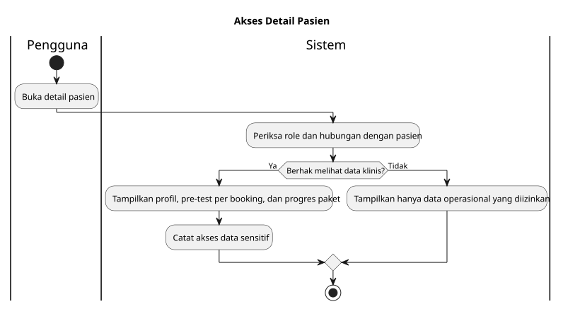
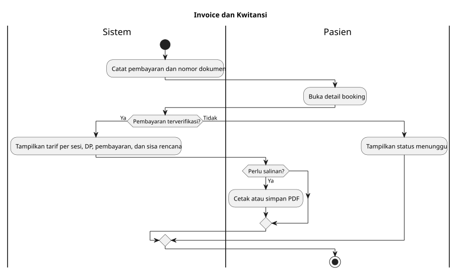

# Audit dan Flow Fitur JiwaSehat

> Flow berikut merekam preview Eko. Untuk target integrasi gunakan [keputusan final](../KEPUTUSAN_FINAL_2026_10_22.md), [BUSINESS_RULES](../BUSINESS_RULES.md) dan F01-F20. Flow per-sesi/hak Admin/request reschedule target masih perlu migrasi source.


Tanggal audit statis terakhir: 21 Oktober 2026  
Status dokumen: hasil audit statis frontend, dokumentasi, dan PDF acuan  
Ruang lingkup: flow target, kondisi prototype, serta pekerjaan backend/QA yang tersisa

## 1. Tujuan Dokumen

Dokumen ini menjadi peta alur setiap fitur JiwaSehat sekaligus daftar celah yang masih harus diselesaikan. Audit dilakukan terhadap source React/Vite TypeScript, mock data, LocalStorage, kontrak service API, dokumentasi pada folder `Live Docs`, `MoU WEBSITE.pdf`, dan `paket untuk website.pdf`.

Audit ini tidak menjalankan aplikasi, test, build, atau dev server. Karena itu, kesimpulan UI responsif bersifat audit kode statis dan masih wajib dibuktikan melalui UAT perangkat nyata.

## 2. Kesimpulan Audit

Prototype telah diperbaiki untuk konfirmasi ulang reschedule, snapshot pre-test/consent, audit status, dan pembatalan seluruh rencana setelah lunas. Runtime masih mock/LocalStorage; hasil audit statis belum membuktikan kelulusan QA browser atau keamanan produksi.

Tindak lanjut audit 21 Oktober menambahkan katalog berskala, progres pembayaran, nominal aktual, laporan per tanggal penerimaan, guard harga/jadwal, dan audit sesi baru. Tujuh temuan berikutnya juga ditangani pada prototype melalui satu Web Lock, snapshot atomik, hold sebelum transfer, pencocokan bukti, CSRF, jam stabil, modal terbaru, dan encoder ekspor. Hold server masih kontrak; 17 tes logika lolos, bukan UAT/keamanan produksi. Lihat [[KNOWN_ISSUES]].

Prioritas tertinggi:

1. Menjalankan QA setelah diizinkan, termasuk cancel setelah lunas, reschedule terbayar, dan histori pre-test.
2. Memindahkan snapshot, consent, pembayaran, audit, dan penguncian slot ke transaction backend.
3. QA konfirmasi manual keterlambatan/no-show dan jadwal pengganti tanpa DP baru (keputusan 22 Oktober 2026); cancel tetap manual setelah lunas.
4. Menentukan jatuh tempo cicilan serta koreksi/refund berotorisasi.
5. Menghubungkan AppContext ke service Laravel dan menguji Resource admin tanpa nominal/data klinis.
6. Tidak menambahkan reupload bukti sesuai keputusan developer. Transaksi belum cocok tetap pending untuk pemeriksaan manual.

## 3. Sumber Kebenaran dan Hak Akses

Jika terdapat perbedaan aturan, urutan sumber kebenaran yang digunakan adalah:

1. Arahan terbaru developer/klien yang sudah disepakati.
2. `DECISIONS.md` dan `BUSINESS_RULES.md`.
3. Spesifikasi backend/API.
4. MoU sebagai ruang lingkup umum.
5. Implementasi frontend saat ini.

Catatan: MoU memberi hak admin yang cukup luas, sedangkan keputusan terbaru membatasi admin sebagai petugas operasional. Implementasi final harus mengikuti keputusan terbaru dan batas ini harus ditegakkan kembali oleh Laravel Policy, bukan hanya menyembunyikan tombol di frontend.

| Peran | Hak utama yang dituju | Larangan utama |
|---|---|---|
| Psikolog/Pengelola | Mengelola paket, harga, diskon, jadwal, CMS, status klinis, paket berjalan, keuangan, laporan, dan data klinis sesuai kebutuhan | Tidak boleh mengubah histori pembayaran tanpa jejak audit |
| Admin | Memantau pengguna/booking, memeriksa bukti, mengonfirmasi booking, membuat walk-in, reschedule, mencatat uang masuk secara write-only, dan moderasi ulasan | Tidak melihat harga paket, laporan keuangan, CMS, atau menyelesaikan/membatalkan sesi |
| Pasien | Melengkapi profil, memilih paket/jadwal, mengisi pre-test, menyetujui consent, membayar, reschedule, melihat histori/receipt, dan memberi ulasan | Tidak mengubah status konsultasi atau mengakses data pasien lain |

## 4. Ringkasan Status Utama

Bagian ini mencatat nama status. Sumber UML activity diagram ada di [ACTIVITY_DIAGRAMS.md](../ACTIVITY_DIAGRAMS.md); gambar tiap fitur tampil langsung pada bagian alurnya di bawah.

### 4.1 Status Janji Temu

Alur target normal:

```text
PENDING
  -> CONFIRMED
  -> IN_PROGRESS (opsional, harus diputuskan)
  -> COMPLETED
```

Cabang khusus:

```text
CONFIRMED -> NO_SHOW
NO_SHOW -> CONFIRMED (reschedule manual oleh psikolog yang menangani, sesi sama, tanpa DP kedua)
CONFIRMED -> CANCELLED
PENDING/CONFIRMED -> RESCHEDULE -> PENDING/CONFIRMED sesuai pelaku
```

Aturan:

- Admin hanya mengonfirmasi booking setelah bukti pembayaran diperiksa.
- Admin tidak boleh mengubah status menjadi completed, cancelled, atau no-show.
- Psikolog yang menandai completed, no-show, atau cancelled.
- Booking dan tanggal pengganti reschedule minimal H+1 berdasarkan zona waktu praktik.
- Perubahan status harus menyimpan pelaku, waktu, alasan, dan status sebelum/sesudah.

Status `IN_PROGRESS` sudah ada di model tetapi belum mempunyai aksi UI. Harus dipilih: dipakai secara resmi atau dihapus agar state machine tidak palsu.

### 4.2 Status Pembayaran

Alur target dasar:

```text
DP_PENDING_VERIFICATION
  -> DP_PAID
  -> PAID
```

Tidak ada status/aksi permintaan unggah ulang bukti. Jika transaksi belum dapat dicocokkan, admin menahan konfirmasi untuk pemeriksaan manual.

Aturan:

- DP awal flat Rp100.000.
- Admin melihat bukti dan identitas transaksi, tetapi tidak melihat harga paket.
- Admin memasukkan nominal aktual yang diterima. Setelah tersimpan, nominal tersebut tidak dapat dibaca kembali oleh admin.
- Psikolog/pengelola dapat melihat laporan uang masuk.
- Konfirmasi DP dan perubahan booking ke `CONFIRMED` harus atomik di backend.
- `FINAL_PENDING_VERIFICATION` dan `REFUNDED` sudah ada di tipe tetapi belum memiliki alur lengkap.

### 4.3 Status Paket Berjalan

```text
ACTIVE -> COMPLETED (seluruh sesi selesai)
ACTIVE -> DISCONTINUED (cancel oleh psikolog setelah pembayaran lunas)
```

Satu sesi berikutnya hanya boleh dibuat jika belum ada sesi aktif lain untuk paket yang sama. Backend harus memakai transaksi, idempotency key, dan pemeriksaan bentrok.

## 5. Audit Flow Setiap Fitur

UML activity diagram berikut menampilkan aktivitas, percabangan, dan swimlane pelaku. Sumbernya ada di [ACTIVITY_DIAGRAMS.md](../ACTIVITY_DIAGRAMS.md). Bagian **Belum lengkap** di bawah tiap gambar menjelaskan selisih terhadap implementasi saat ini.

### 5.1 Landing Page dan Katalog Paket

**Diagram aktivitas:**


**Aktor:** pengunjung.  
**Flow target:** pengunjung membuka landing page -> melihat profil layanan, paket, tarif/diskon aktif, testimonial, FAQ, kontak/medsos, consent/privacy -> memilih paket atau masuk dengan Google.

**Sudah ada:** landing page, daftar paket, carousel pengalaman/testimonial, tautan sosial, CTA booking, dan penghilangan klaim “berlisensi resmi”.  
**Belum lengkap:** konten masih mock/CMS lokal, beberapa teks dokumentasi masih menyebut layanan tatap muka saja padahal telelayanan tersedia, dan aset CMS belum memakai upload/storage backend.

### 5.2 Login Google dan Registrasi Pasien

**Diagram aktivitas:**



**Aktor:** pengunjung/pasien.  
**Flow target:** klik Google SSO -> backend Socialite memvalidasi identitas -> pengguna lama masuk -> pengguna baru dibuat sebagai pasien -> diarahkan melengkapi profil -> profil lengkap membuka dashboard.

**Sudah ada:** simulasi Google login dan gate profil.  
**Belum lengkap:** login masih timeout/hardcoded, quick-login testing masih terlihat, belum ada token/session Laravel, logout server, penanganan akun Google tanpa email, akun dinonaktifkan, atau duplikasi email. Dokumentasi juga belum konsisten apakah produksi hanya Google atau ikut email/password.

### 5.3 Kelengkapan Profil Pasien

**Diagram aktivitas:**


**Aktor:** pasien baru.  
**Flow target:** mengisi identitas dan general information -> validasi -> simpan -> dashboard aktif -> data dipakai untuk booking dan kebutuhan psikolog.

**Sudah ada:** halaman dan blokir akses sebelum profil lengkap.  
**Belum lengkap:** validasi backend, versi histori perubahan, kebijakan field wajib, dan alur klaim akun pasien walk-in belum ditentukan. Istilah “asesmen mandiri” pada UI perlu diselaraskan karena scope saat ini hanya pre-test profiling.

### 5.4 Hak Akses dan Navigasi Dashboard

**Diagram aktivitas:**


**Aktor:** semua role.  
**Flow target:** backend mengirim user/ability -> frontend hanya menampilkan menu yang diizinkan -> setiap request kembali diperiksa Laravel Policy.

**Sudah ada:** dashboard terpisah, sidebar dapat diciutkan, dan menu per role.  
**Belum lengkap:** enforcement masih frontend/mock. Folder komponen bernama `admin` juga berisi CMS/analitik yang sebenarnya dipakai psikolog; bukan kebocoran runtime, tetapi rawan salah pakai saat migrasi.

### 5.5 Pengelolaan Paket, Tarif, Fasilitas, dan Diskon

**Diagram aktivitas:**



**Aktor:** psikolog/pengelola.  
**Flow target:** buat/edit paket -> tentukan kategori, durasi, sesi, tarif, DP flat, fasilitas, catatan, dan diskon -> aktif/nonaktifkan -> pasien melihat harga efektif -> setiap booking menyimpan snapshot paket dan harga saat transaksi.

**Sudah ada:** CRUD mock, fasilitas dinamis, paket multi-sesi, diskon tanpa voucher, dan paket dummy dari PDF.  
**Belum lengkap:** snapshot harga/discount backend, periode diskon, aturan bentrok diskon, dan audit perubahan tarif. Biaya kelebihan waktu serta surat laporan cukup menjadi notes paket sesuai arahan klien; tidak ada penagihan otomatis untuk dua catatan itu pada scope sekarang.

### 5.6 Pengaturan Jam Kerja, Hari Libur, Override, dan Kuota

**Diagram aktivitas:**



**Aktor:** psikolog/pengelola.  
**Flow target:** atur jam mingguan -> atur jeda/kuota -> tandai hari libur atau override tanggal -> sistem menghasilkan slot sesuai durasi paket -> slot aktif dikurangi booking yang mengunci.

**Sudah ada:** konfigurasi jam kerja, hari libur, override, kuota harian, durasi paket, dan pemeriksaan overlap.  
**Belum lengkap:** penyimpanan backend dan locking lintas transaksi. Prototype kini menolak Save bila libur/jam/kuota baru berbenturan dengan booking aktif; tidak menggusur booking. Waktu validasi memakai WIB.

### 5.7 Booking Mandiri Pasien

**Diagram aktivitas:**


**Aktor:** pasien.  
**Prasyarat:** login, profil lengkap, paket aktif, tanggal minimal H+1, dan slot tersedia.

**Flow target:** cari/filter/urutkan layanan -> pilih tanggal dan slot -> isi pre-test dan consent -> server membuat hold dan quote valid -> tampilkan instruksi bayar -> unggah bukti DP -> kirim dengan hold/expected total -> backend validasi ownership, expiry, quote, kuota dan overlap secara atomik -> booking `PENDING` + pembayaran `DP_PENDING_VERIFICATION` -> notifikasi. Transfer setelah expiry masuk rekonsiliasi, bukan kehilangan bukti/uang.

**Sudah ada:** katalog satu baris horizontal berpagination enam item dengan pencarian/filter/urutan, notes penuh langsung di kartu, dan dialog rincian; wizard H+1 WIB, slot dinamis, sinkronisasi katalog/guard total berubah, snapshot pre-test dan consent versi aktif, serta pengikatan draft setelah booking berhasil.  
**Belum lengkap:** hold server masih kontrak. Runtime mock sudah menahan kapasitas sebelum instruksi transfer, memulihkan reservasi setelah refresh, dan menyimpan bukti setelah expiry/quote berubah sebagai kasus pencocokan. TTL produksi, transaction/idempotency antarperangkat, session nyata, serta cleanup draft tetap pekerjaan backend. Default 15 menit hanya prototype.

### 5.8 Pre-Test Profiling

**Diagram aktivitas:**



**Aktor:** pasien mengisi; psikolog membaca.  
**Flow target:** pasien mengisi pre-test untuk booking tertentu -> validasi -> hasil disimpan dengan `appointment_id`, versi pertanyaan, dan timestamp -> psikolog melihat snapshot yang tepat sebelum sesi.

**Sudah ada:** draft terbaru per pasien dan snapshot immutable pada booking (`preTestId/preTestSnapshot`). Pengisian baru tidak mengubah booking lama. Psikolog dapat memilih snapshot janji temu di detail pasien. Riwayat terapi/obat/risiko yang tidak ditanyakan tetap absen.  
**Belum lengkap:** database/versioning backend. Booking legacy tidak mempunyai snapshot yang dapat direkonstruksi dengan jujur; form terbaru hanya ringkasan/prefill.

Scope pre-test hanya profiling sebelum booking. Tes DASS/tes psikolog online bukan scope aktif kecuali klien menambahkannya sebagai fitur baru.

### 5.9 Consent dan Privasi

**Diagram aktivitas:**


**Aktor:** pasien.  
**Flow target:** tampilkan dokumen consent/privacy versi aktif -> pasien membaca dan menyetujui -> backend menyimpan versi, waktu, user, booking, IP, dan user agent -> receipt/audit dapat membuktikan persetujuan.

**Sudah ada:** checkbox, kebijakan privasi, validasi versi aktif, dan snapshot consent pada booking dengan pasien serta timestamp.  
**Belum lengkap:** penyimpanan backend yang immutable, metadata request server, dan lifecycle publikasi versi kebijakan.

### 5.10 Verifikasi DP dan Bukti Pembayaran

**Diagram aktivitas:**



**Aktor:** pasien dan admin.  
**Flow target:** pasien mengunggah gambar bukti -> file private tersimpan -> admin membuka preview gambar -> admin memeriksa nama pengirim/metode/rekening -> opsional menulis catatan internal -> konfirmasi -> booking menjadi `CONFIRMED` dan DP menjadi `DP_PAID` dalam satu transaksi.

**Sudah ada:** modal preview gambar, metadata pembayaran, dan konfirmasi atomik pada simulasi. Nomor referensi sudah tidak diperlukan.  
**Belum lengkap:** storage private/signed URL, validasi file server, dan audit permanen. Reupload sengaja tidak ditambahkan. Admin mencocokkan bukti dengan mutasi/catatan penerimaan, menahan konfirmasi bila belum cocok, dan tidak mempunyai hak cancel.

### 5.11 Booking Walk-In oleh Admin

**Diagram aktivitas:**


**Aktor:** admin.  
**Flow target:** cari pasien -> jika belum ada, buat draft pasien -> pilih jadwal minimal H+1 -> pilih metode cash/bank -> masukkan data pembayaran -> backend memvalidasi slot -> buat pasien dan booking secara atomik -> kirim petunjuk klaim akun/profil/pre-test.

**Sudah ada:** booking pasien lama/baru, pilihan metode, input nominal penerimaan DP/FULL aktual, dan validasi nominal tanpa menampilkan target tagihan. Ledger awal dihitung sebagai kas setelah verifikasi.  
**Belum lengkap:** user baru dipersistenkan setelah booking berhasil, tetapi atomicity database tetap pekerjaan backend. Email sintetis belum memiliki flow klaim akun. Pre-test awal boleh dilewati admin. FULL awal psikoterapi tetap dilarang; pembayaran berikutnya mengikuti aturan sesi pertama/penghentian.

### 5.12 Reschedule Pasien, Admin, dan Psikolog

**Diagram aktivitas:**



**Aktor:** pasien, admin, atau psikolog yang menangani.  
**Flow target:** pilih booking yang diizinkan -> pilih tanggal pengganti minimal H+1 -> ambil slot terbaru -> pilih alasan -> backend lock slot baru dan melepas slot lama dalam satu transaksi -> simpan histori pelaku/alasan/waktu -> status akhir mengikuti kebijakan -> kirim notifikasi.

**Sudah ada:** H+1 WIB, slot tersedia, alasan/pelaku dan daftar `rescheduleHistory`. Aksi konfirmasi ulang admin menerima `PENDING + DP_PAID/PAID`, mempertahankan pembayaran dan audit verifikasi awal.  
**Konfirmasi manual psikolog:** keterlambatan tidak memicu cancel/status otomatis. Psikolog dapat memindahkan sesi terkonfirmasi atau `NO_SHOW` sesuai hasil konfirmasi. Pemulihan `NO_SHOW -> CONFIRMED` memakai appointment dan nomor sesi yang sama, mempertahankan DP/cicilan/saldo, tanpa DP atau bukti baru. Admin/pasien tidak dapat membuka kembali `NO_SHOW` sendiri. Ikon tersedia di Riwayat Sesi dan Paket Berjalan psikolog.  
**Belum lengkap:** transaction backend, batas jumlah/cutoff, serta QA browser/perangkat. Prototype memakai identitas jam stabil tanpa fallback ke pilihan lain; jika slot hilang pasien wajib memilih ulang.

### 5.13 Pelaksanaan dan Penyelesaian Konsultasi

**Diagram aktivitas:**



**Aktor:** psikolog.  
**Flow target:** booking confirmed -> psikolog memulai sesi jika status `IN_PROGRESS` dipakai -> setelah layanan, psikolog menandai completed/no-show/cancelled -> wajib alasan untuk status pengecualian -> audit tersimpan -> paket dan pembayaran diperbarui sesuai aturan.

**Sudah ada:** psikolog dapat menandai completed, no-show, dan cancelled; admin tidak dapat melakukannya.  
**Sudah diperbaiki:** alasan wajib untuk no-show/cancel, audit status, batas waktu WIB, dan cancel seluruh rencana hanya setelah lunas. Histori completed dipertahankan.  
**Keputusan 22 Oktober 2026:** keterlambatan/ketidakhadiran dikonfirmasi manual psikolog; boleh melanjutkan sesi terkonfirmasi atau reschedule sesi yang sama ke H+1, tanpa DP kedua. Tidak ada auto-cancel, auto-completed, atau sesi otomatis hangus.  
**Belum lengkap:** keputusan penggunaan `IN_PROGRESS`, QA browser, dan audit permanen backend.

### 5.14 Pembayaran Bertahap

**Diagram aktivitas:**


**Aktor:** admin mencatat; psikolog melihat hasil agregat.  
**Flow target:** setelah sesi pertama, pasien dan psikolog menyepakati pelunasan sekaligus atau cicilan -> admin mencatat nominal aktual tiap kali uang diterima -> ledger mengurangi saldo -> status `PAID` hanya ketika saldo nol -> nilai tetap write-only bagi admin.

**Sudah ada:** admin mencatat nominal aktual dan tanggal penerimaan secara write-only. Pasien/psikolog melihat terbayar dari total dan sisa; saldo hanya berkurang oleh penerimaan terverifikasi. Nominal tidak dapat dibaca ulang dari UI admin.  
**Belum lengkap:** kesepakatan/jatuh tempo cicilan belum terstruktur. Pembayaran biasa psikoterapi setelah sesi pertama; admin dapat mencatat pelunasan untuk penghentian lebih awal dengan purpose khusus. Ledger masih LocalStorage; koreksi/refund berotorisasi dan persetujuan cicilan independen belum ada.

### 5.15 Paket Berjalan dan Penjadwalan Sesi Berikutnya

**Diagram aktivitas:**



**Aktor:** psikolog.  
**Flow target:** booking psikoterapi dengan tarif per sesi dan rencana awal minimal empat pertemuan -> admin verifikasi DP -> psikolog menyelesaikan sesi pertama -> psikolog menjadwalkan sesi ke-2 sampai ke-4 satu per satu pada slot H+1 -> progres bertambah hanya saat sesi completed -> rencana menjadi completed. Jika terapi perlu diteruskan, pasien booking psikoterapi lagi dengan kode/DP/ledger baru; penomoran sesi klinis lanjutan dicatat di rekam medis di luar web.

**Sudah ada:** tabel progres empat sesi, progres pembayaran aktual, penjadwalan bertahap, CTA booking ulang, dan pembayaran parsial. Appointment baru memiliki histori status/jadwal sendiri tanpa ledger DP atau histori reschedule sesi sebelumnya. Tidak ada aksi penambahan sesi.  
**Kondisi terkini:** cancel menghentikan rencana dan membatalkan seluruh sisa appointment setelah lunas; tidak ada sesi lanjutan pada plan itu. No-show tetap pencatatan terpisah, pengganti/jatah belum diputuskan. Entity treatment plan, jatuh tempo cicilan, dan ledger permanen menunggu backend. Hubungan klinis booking lama/baru tetap di rekam medis eksternal sesuai scope.

### 5.16 Detail Pasien dan Data Klinis

**Diagram aktivitas:**



**Aktor:** psikolog; admin hanya data operasional minimum.  
**Flow target:** psikolog membuka pasien -> melihat profil, booking, pre-test per sesi, treatment plan, dan histori status -> data sensitif tidak tersedia untuk admin -> seluruh akses diaudit.

**Sudah ada:** panel/detail pasien dan ringkasan pre-test.  
**Belum lengkap:** data masih LocalStorage, belum ada field-level authorization, audit akses, retensi, koreksi data, ekspor per pasien, atau penghapusan/anonymization. Klaim triase risiko belum konsisten dengan data yang benar-benar dikumpulkan.

### 5.17 Invoice, Kwitansi, dan Receipt

**Diagram aktivitas:**



**Aktor:** pasien dan psikolog/pengelola.  
**Flow target:** setiap transaksi menghasilkan nomor dan record immutable -> pasien dapat membuka setelah pembayaran -> pilih cetak/simpan PDF/screenshot -> dokumen menampilkan booking, metode, uang yang benar-benar diterima, dan riwayat reschedule bila diperlukan.

**Sudah ada:** detail janji temu dan tombol print/save PDF dari browser.  
**Belum lengkap:** dokumen belum diterbitkan backend dan belum memiliki versi/hash. Detail pasien membedakan DP menunggu verifikasi dengan DP terbayar serta menunjukkan tarif per sesi untuk psikoterapi. Receipt prototype masih mencerminkan saldo rencana terkini, bukan dokumen historis immutable.

### 5.18 Ulasan dan Moderasi

**Diagram aktivitas:**


**Aktor:** pasien memberi ulasan setelah sesi selesai; admin memoderasi.  
**Flow target:** pasien mengirim satu ulasan untuk booking completed -> status pending -> admin publish/reject dengan catatan -> keputusan tersimpan -> konten published tampil di landing bila diizinkan.

**Sudah ada:** submit dan moderasi.  
**Belum lengkap:** mock menghapus ulasan saat reject sehingga audit hilang. Ulasan rejected harus tetap disimpan dengan moderator, waktu, alasan, dan status. Aturan edit ulang dan pelaporan konten juga belum ada.

### 5.19 CMS dan Media

**Diagram aktivitas:**


**Aktor:** psikolog/pengelola.  
**Flow target:** edit konten -> upload/select media -> preview -> publish -> landing membaca versi published -> perubahan memiliki histori/draft.

**Sudah ada:** pengaturan konten utama dan URL gambar.  
**Belum lengkap:** upload asset service belum tersambung ke runtime, tidak ada draft/publish/versioning, rollback, validasi media, alt text wajib, atau cleanup file yang tidak dipakai.

### 5.20 Laporan Keuangan dan Export

**Diagram aktivitas:**


**Aktor:** psikolog/pengelola.  
**Flow target:** pilih periode/filter -> backend mengambil transaksi resmi -> hitung uang masuk berdasarkan payment records -> preview -> unduh PDF berkop atau XLSX -> aktivitas export diaudit.

**Sudah ada:** ruang preview, filter periode penerimaan, pagination kertas A4, print/save PDF, Excel/CSV simulasi, dan ringkasan arus kas per event pembayaran. DP dan setiap cicilan masuk periode masing-masing; reschedule tidak memindahkan kas. Rata-rata dihitung per penerimaan, tanggal legacy tidak pasti diberi label estimasi.  
**Belum lengkap:** PDF masih browser print, Excel masih format client-side, dan sumber uang masuk belum ledger backend. Export data besar, keamanan file, dan akurasi tanggal historis tetap perlu QA/rekonsiliasi.

### 5.21 Backup/Export Data Klinis

**Diagram aktivitas:**


**Aktor:** psikolog/pengelola.  
**Flow target:** pilih scope -> autentikasi ulang -> backend membuat export terenkripsi/terbatas -> signed download dengan masa berlaku -> audit -> kebijakan retensi dan restore diuji.

**Sudah ada:** export client sebagai prototipe.  
**Belum lengkap:** belum merupakan backup, tidak ada enkripsi, akses sementara, job queue, checksum, restore test, atau kebijakan retensi.

### 5.22 Notifikasi WhatsApp

**Diagram aktivitas:**


**Aktor:** sistem, pasien, psikolog, dan admin sesuai event.  
**Flow target:** event booking/payment/reschedule/session dibuat -> backend queue membuat pesan -> provider WhatsApp mengirim -> delivery status/log tersimpan -> kegagalan retry -> tautan menuju halaman web yang tepat.

Event minimum:

- booking pending ke admin dan pasien;
- pembayaran dikonfirmasi ke pasien;
- reschedule ke pasien dan psikolog;
- pengingat jadwal ke pasien dan psikolog;
- sesi berikutnya paket ke pasien;
- tindak lanjut manual pembayaran belum cocok, bila kanal operasional menyediakannya; bukan permintaan reupload dalam aplikasi.

**Sudah ada:** kontrak service dasar.  
**Belum lengkap:** belum ada trigger runtime, provider, template, consent komunikasi, queue, retry, delivery log, preference, atau fallback. Fitur ini memang dominan backend, tetapi frontend tetap perlu menampilkan status pengiriman bila operasional membutuhkannya.

### 5.23 Tampilan Mobile, Sidebar, Loading, dan Error

**Diagram aktivitas:**


**Aktor:** semua pengguna.  
**Flow target:** seluruh tugas utama dapat dilakukan pada 320/375/430 px tanpa konten terpotong, tabel memiliki pola mobile, tombol mudah disentuh, toast tidak menutup aksi, dan loading/error/empty state konsisten.

**Sudah ada:** sidebar collapsible, responsive cards pada beberapa tabel, dan perbaikan layout mobile.  
**Belum lengkap:** belum dilakukan UAT runtime lintas perangkat. Screenshot terakhir menunjukkan toast login menutupi konten bawah. Perlu audit semua modal, tabel paket berjalan, booking slot, laporan print, keyboard focus, screen reader label, long text, safe area iOS, dan zoom 200%.

## 6. Celah Implementasi Berdasarkan Prioritas

### P0 - Wajib Sebelum Backend/UAT Final

| Masalah | Dampak | Perbaikan yang dibutuhkan |
|---|---|---|
| Snapshot pre-test/consent baru di LocalStorage | Histori belum aman untuk produksi | Persistenkan draft, binding dan consent dalam transaction Laravel |
| Slot lock hanya simulasi frontend | Double booking saat request bersamaan | DB transaction, overlap guard, idempotency, dan validasi ulang server |
| Sesi no-show | Tidak berjalan otomatis | Psikolog mengonfirmasi manual dan dapat reschedule sesi yang sama H+1 tanpa DP baru; QA browser/backend masih diperlukan |
| Cancel/discontinue baru atomic pada array prototype | Konflik lintas perangkat masih mungkin | Transaction ledger + seluruh appointment terkait di backend |
| Walk-in baru menunda persistensi user sampai berhasil | Belum transaction database | Buat user dan booking dalam satu transaction Laravel |
| Auth/authorization masih mock | Data sensitif tidak aman | Laravel Sanctum/Socialite, Policy, validation, dan audit log |

### P1 - Wajib Untuk Flow Operasional Lengkap

| Masalah | Perbaikan yang dibutuhkan |
|---|---|
| Pengecualian pelunasan penghentian perlu Policy backend | Purpose penghentian boleh sebelum sesi pertama; admin hanya mencatat uang |
| Cicilan baru simulasi LocalStorage; koreksi/refund belum ada | Payment ledger backend dan workflow koreksi berotorisasi |
| `IN_PROGRESS` tidak terpakai | Implementasikan atau hapus dari model |
| Audit status/reschedule masih LocalStorage | Pindahkan daftar event ke tabel immutable backend |
| Receipt belum immutable | Generate invoice/receipt backend dengan nomor unik |
| Rejected review dihapus | Simpan status rejected dan moderation log |
| Notifikasi belum berjalan | Queue/provider WhatsApp dan delivery log |
| CMS upload belum terhubung | Private/public storage dan asset lifecycle |
| Treatment plan masih hasil grouping | Buat entity treatment plan dan treatment sessions |
| Ringkasan risiko prototype belum tervalidasi klinis | Pertahankan scope profiling; data yang tidak ditanyakan tetap tidak diketahui |

### P2 - Kualitas, Konsistensi, dan Penyelesaian Produk

- Hubungkan seluruh controller/context ke service API dan hapus dual contract mock secara bertahap.
- Tambahkan loading, retry, timeout, offline, empty, dan permission-denied state.
- Audit mobile 320/375/430 px, tablet, desktop, print A4, keyboard, dan screen reader.
- Buat export PDF/XLSX resmi dari backend untuk data besar.
- Tambahkan backup terenkripsi dan uji restore.
- Samakan istilah telelayanan, pre-test, asesmen, pembayaran, dan status pada UI/dokumentasi.
- Bersihkan state/route lama yang tidak dipakai setelah migrasi selesai.
- Tambahkan test unit state machine, integration API, concurrency booking, authorization, dan end-to-end per role.

## 7. Ketidakcocokan Dokumentasi dan Implementasi

| Area | Ketidakcocokan |
|---|---|
| Scope layanan | README sudah mencakup telelayanan; histori keputusan lama harus dibaca bersama revisi terbaru |
| Tes psikolog | Source dan spesifikasi aktif hanya pre-test; klaim residu tabel DASS pada audit lama dikoreksi |
| Pembayaran | Nomor referensi transfer tidak digunakan; invoice/booking tetap identitas transaksi |
| Login | UI Google simulasi/quick-login; FEATURES dan TODO sudah dikoreksi, login nyata menunggu backend |
| Status | IN_PROGRESS dan FINAL_PENDING_VERIFICATION tetap tipe legacy tanpa aksi aktif |
| Risiko klinis | Data tidak ditanyakan tidak lagi diisi default negatif; ringkasan prototype belum validasi klinis |
| Reschedule | FAQ diselaraskan ke tanggal pengganti H+1 sejak hari pengajuan |
| Endpoint | Mock endpoint dan endpoint service Laravel memakai path berbeda; service harus menjadi kontrak final |
| Admin | MoU memberi hak umum yang lebih luas daripada keputusan terbaru; Policy final harus mengikuti keputusan terbaru |

## 8. Keputusan Klien yang Masih Dibutuhkan

1. Berapa lama booking pending yang belum dapat dicocokkan pembayarannya boleh menahan slot? Reupload tidak termasuk scope.
2. Apakah status `IN_PROGRESS` benar-benar diperlukan?
3. Sudah diputuskan 22 Oktober: no-show/keterlambatan dikonfirmasi manual psikolog; reschedule memakai sesi sama tanpa DP lagi, bukan penambahan jatah atau cancel otomatis. Tinggal QA dan implementasi backend.
4. Aturan cancel sudah final: lunas dahulu lalu hentikan seluruh sisa rencana. Prosedur koreksi/refund terpisah masih perlu keputusan.
5. Bagaimana tanggal jatuh tempo cicilan dicatat dan apa yang terjadi bila pasien terlambat membayar?
6. Paket asesmen hanya menjual layanan asesmen atau aplikasi juga harus menyediakan pengerjaan alat tes online?
7. Berapa batas maksimal reschedule dan cutoff sebelum jadwal lama?
8. Berapa lama booking pending menahan slot sebelum pembayaran kedaluwarsa?
9. Apakah pasien walk-in wajib mengklaim akun dan mengisi pre-test sebelum sesi dimulai?
10. Detail session Google SSO mengikuti integrasi Laravel; login email/password bukan UI aktif.
11. Bagaimana psikolog memberikan tautan meeting pihak ketiga secara aman kepada pasien terkonfirmasi?

## 9. Kontrak Backend Minimum

Backend Laravel 12+ dan MySQL minimal harus menyediakan:

- autentikasi Google, session/token, logout, account status, dan Policy per role;
- user/patient profile dan flow klaim akun walk-in;
- package, package benefit, discount, price snapshot, dan audit perubahan;
- working hours, holidays, overrides, quota, dan availability;
- appointment state machine, lock slot, idempotency, expiry, dan audit;
- pre-test per appointment dengan versioning;
- consent record dengan versi dan metadata audit;
- private payment proof dan verifikasi manual tanpa fitur reupload, payment ledger, invoice/receipt, serta adjustment/refund berotorisasi bila kelak disepakati;
- first-class treatment plan empat sesi, treatment session, booking ulang sebagai plan baru, dan payment ledger;
- reschedule history;
- review dan moderation history;
- CMS version, asset storage, dan publish flow;
- report PDF/XLSX, clinical export, backup, serta audit download;
- WhatsApp queue, template, retry, dan delivery log.

## 10. Definition of Done Frontend

Frontend baru dapat disebut selesai ketika:

1. Semua state transition di dokumen ini dapat dilakukan tanpa kondisi buntu.
2. Seluruh layar memakai service API final, bukan LocalStorage/mock untuk data operasional.
3. Role restriction teruji dari UI dan respons 403 backend.
4. Booking bersamaan tidak menghasilkan double booking.
5. Pre-test, consent, pembayaran, reschedule, dan status memiliki histori yang benar.
6. Paket berjalan berhasil untuk completed, no-show, cancelled, reschedule, dan discontinued.
7. Semua layar utama lulus UAT mobile, desktop, keyboard, dan print.
8. Loading, error, retry, empty, timeout, dan permission state tersedia.
9. PDF/XLSX/receipt menggunakan data backend dan hasilnya terverifikasi.
10. Quick-login, data dummy, endpoint mock, dan teks debug tidak muncul pada build produksi.

## 11. Referensi Audit

- `resources/js/context/AppContext.tsx`
- `resources/js/controllers/PatientController.ts`
- `resources/js/controllers/AdminController.ts`
- `resources/js/controllers/PsychologistController.ts`
- `resources/js/components/patient/`
- `resources/js/components/admin/`
- `resources/js/components/psychologist/`
- `resources/js/services/`
- `resources/js/types/index.ts`
- `BUSINESS_RULES.md`
- `DECISIONS.md`
- `FEATURES.md`
- `API.md`
- `LARAVEL_API_SPEC.md`
- `BACKEND_PACKAGE_AND_TREATMENT_PLAN_SPEC.md`
- `ROLES_PERMISSIONS.md`
- `KNOWN_ISSUES.md`
- `TODO.md`
- `MoU WEBSITE.pdf`
- `paket untuk website.pdf`
